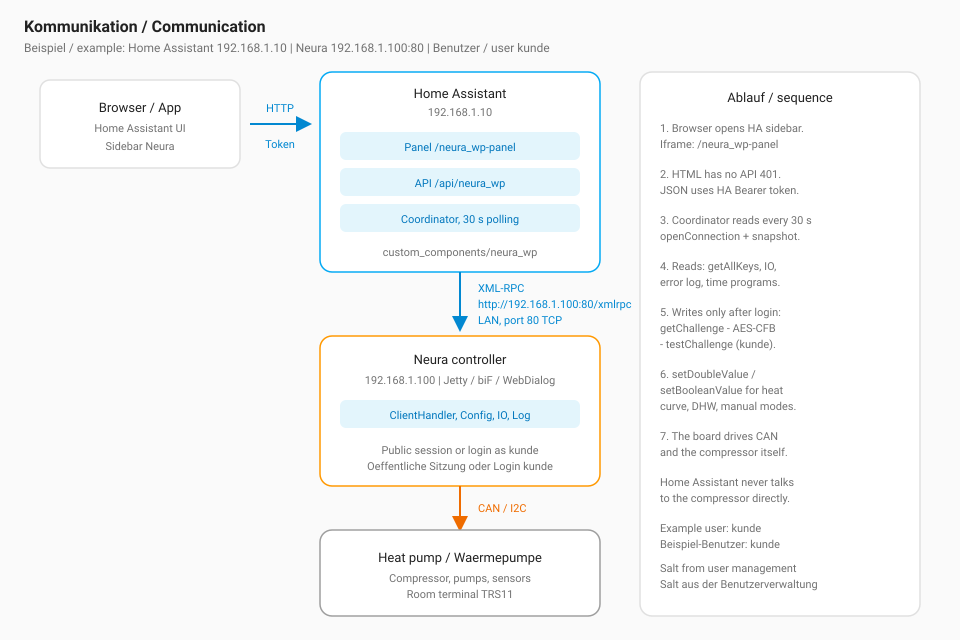
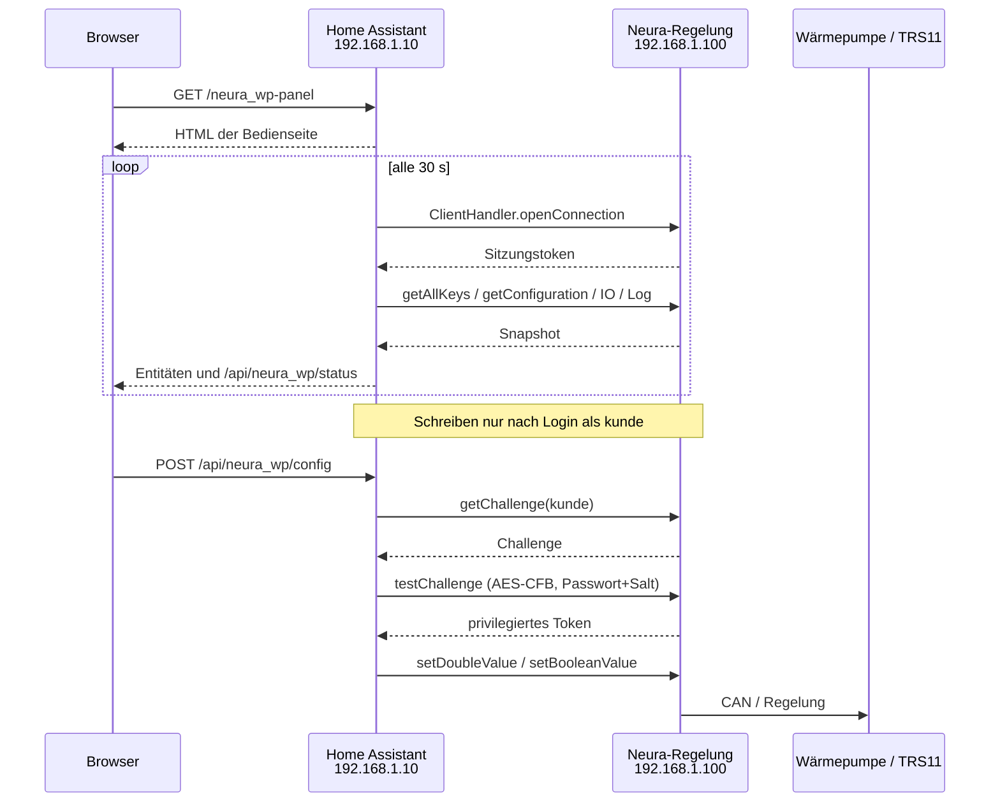

# Neura Wärmepumpe für Home Assistant

Benutzerdefinierte Integration (`neura_wp`), die eine Neura-Wärmepumpe mit WebDialog / biF im Heimnetz an Home Assistant anbindet.

Die **Regelung bleibt auf der Platine**. CAN, Raumterminal (TRS11) und Verdichterlogik werden nicht ersetzt. Home Assistant liest denselben XML-RPC-Dienst wie das Original-WebDialog, schreibt dieselben Konfigurationswerte und zeigt die Bedienseite in der Seitenleiste. Ein extra Rechner mit Python-Umgebung ist dafür nicht nötig.

| | Beispiel (bitte ersetzen) |
|---|---|
| Home Assistant | `192.168.1.10` |
| Wärmepumpe | `192.168.1.100` Port `80` |
| Benutzer | `kunde` (Rolle Kunde) |
| Passwort / Salt | nur lokal eintragen, nicht ins Git |

Version **0.2.2**. Abfrage alle **30 Sekunden**.

- [Installation](docs/INSTALLATION.de.md)
- [English version](README.en.md)

## Was die Integration leistet

- Gerät in Home Assistant mit Klima (Heizkurve), Warmwasser, Sensoren, Binärsensoren, Schaltern und Zahlen
- Übersichtswerte als Entitäten, einschließlich Handbetriebe
- Bedienseite unter **Neura** in der linken Seitenleiste (dieselbe Oberfläche wie das lokale Webpanel)
- Lesen ohne Login; Schreiben nur mit Benutzer `kunde` (oder einem anderen Regelungsbenutzer), Passwort und Salt

Sie erzwingt **keinen** ausgeschalteten Verdichter. Ein „Aus“-Modus für die Heizung existiert hier nicht.

## Installation (Kurzform)

1. `custom_components/neura_wp` vollständig nach `config/custom_components/neura_wp` kopieren (`www` nicht weglassen).
2. Home Assistant neu starten.
3. Einstellungen → Geräte und Dienste → Integration hinzufügen → **Neura Wärmepumpe**.
4. Adresse `192.168.1.100`, Port `80`. Für Schreibzugriff Benutzer `kunde`, Passwort und Salt.

Ausführliche Schritte: [docs/INSTALLATION.de.md](docs/INSTALLATION.de.md).

## Kommunikation zwischen Pumpe und Home Assistant

Home Assistant und die Wärmepumpe liegen im selben LAN. Die Integration baut **keine** Cloud-Verbindung auf. Der Browser spricht nur mit Home Assistant; Home Assistant spricht mit der Pumpe.



### Wer mit wem spricht

```
Browser  --HTTP/Session-->  Home Assistant (192.168.1.10)
                                  |
                                  | XML-RPC, Port 80
                                  v
                         Neura-Regelung (192.168.1.100)
                                  |
                                  | CAN / I2C (intern)
                                  v
                         Verdichter, Pumpen, TRS11
```

1. **Browser → Home Assistant**  
   Die Seitenleiste lädt `/neura_wp-panel` in einem Iframe (ohne API-401, das HTML ist nur die Oberfläche). JSON-Aufrufe gehen an `/api/neura_wp/status`, `/heating`, `/cylinder`, `/holiday`, `/config`, `/user`, `/power` und tragen das Home-Assistant-Token mit. Die Pumpe sieht den Browser nicht.

2. **Home Assistant → Regelung**  
   Der Coordinator in `neura_wp` öffnet alle 30 Sekunden eine XML-RPC-Sitzung gegen

   `http://192.168.1.100:80/xmlrpc`

   Der Pfad ist `/xmlrpc` an der Wurzel, nicht unter `/neura`. Die Java-Dienste auf der Platine (Jetty / biF / Apache XML-RPC) erwarten die vollständigen Handler-Namen, zum Beispiel `com.bitservice.bifclient.ClientHandler.openConnection`.

3. **Regelung → Hardware**  
   Nur die Platine spricht CAN und das Raumterminal. Home Assistant ändert höchstens Konfigurationsschlüssel, die das Original-WebDialog auch setzt (`neura.heatcurve.hc_starttemp`, Handbetrieb-Flags, …). Die Verdichterlogik bleibt dort.



### Öffentliche Sitzung und Login

Ohne Benutzer öffnet die Integration nur `openConnection`. Viele Werte lassen sich lesen. Schreiben lehnt die Regelung ohne privilegierte Sitzung ab.

Mit Benutzer `kunde`:

1. `openConnection` liefert ein öffentliches Token.
2. `getChallenge("kunde")` liefert Zufallsbytes.
3. Das Passwort wird mit dem **Salt von kunde** gehasht (SHA-1, 512 Runden), die Challenge mit AES-CFB verschlüsselt (wie das Original-WebDialog).
4. `testChallenge` tauscht das Token gegen eine privilegierte Sitzung.

Das Salt steht in der Benutzerverwaltung der Regelung. Es ist benutzerspezifisch und gehört nicht ins Git.

Läuft die Sitzung ab (`Not authenticated yet`), öffnet der Client sie neu. Die Regelung begrenzt parallele Verbindungen (typisch 10).

### Was geschrieben wird

| Aktion in Home Assistant | XML-RPC (vereinfacht) |
|---|---|
| Heizkurven-Start | `setDoubleValue` auf `neura.heatcurve.hc_starttemp` |
| Warmwasser-Sollwert | erstes Zeitfenster, z. B. `neura.cylinder.timeframe_1_temp` |
| Urlaub | `neura.holiday.active` |
| Handbetriebe | Flags wie `neura.runtime.room_man_temp_flag`, `neura.runtime.cp_endurance_run` |
| FU Handbetrieb | `neura.runtime.pcs_manual` (`-1` = Automatik) |
| Benutzer anlegen / Passwort | `UserManagementClientHandler` |
| Regelung neu starten | `ClientHandler.doRestart` |

Ein Herunterfahren des Pumpenrechners gibt es über XML-RPC nicht. `doRestart` startet nur die Java-Regelung neu.

## Entitäten

Gerät: **Neura Wärmepumpe**. Unique IDs nutzen die Adresse, im Beispiel `192.168.1.100-…`.

### Übersicht

| Entität | Bedeutung |
|---|---|
| Klima *Heizkurve* | Vorlauf, Heizkurven-Start, Kurvenpunkte als Attribute. Nur Modus Heizen. |
| Warmwasser | Sollwert des ersten Zeitfensters, Attribute aktiv/läuft |
| Temperaturen / Drücke | Alle von der Regelung gemeldeten Analogwerte (Vorlauf, Rücklauf, Raum, Außen, …) |
| Digitale Ein- und Ausgänge | Wärmepumpe, Pumpen, Heizstab, Hoch-/Niederdruck, TMAX, EVU-Sperre |
| *Aktueller Heizsollwert* | `neura.heatrequest.targetvalue` |
| Betriebsstunden | Wärmepumpe, Warmwasser, Kompressor, Mischer |
| *Letzter Fehler* | Aktueller Alarm; alte Logeinträge gelten als historisch, nicht als Störung |
| *Zeitprogramme* | Anzahl plus Rohdaten als Attribute |
| *Warmwasser aktiv* | Boilerfreigabe |
| *Schreibzugriff* | Ob die Sitzung als `kunde` (o. ä.) angemeldet ist |
| Schalter *Urlaub* | `neura.holiday.active` |

### Handbetriebe

Dieselben Punkte wie im Original-Menü **Handbetriebe**:

| Entität | Schlüssel |
|---|---|
| Temporärer Handbetrieb | `neura.runtime.room_man_temp_flag` |
| Permanenter Handbetrieb | `neura.runtime.room_man_perm_flag` |
| Mischer temporär / permanent / Zwangslauf | `neura.mixer.temp_flag` / `perm_flag` / `force_run` |
| UWP Dauerlauf | `neura.runtime.cp_endurance_run` |
| Boiler Schnellaufheizung | `neura.cylinder.temporary_load` |
| Schnellaufheizung Temperatur | `neura.cylinder.temporary_temperature` |
| Abtauung erzwingen | `neura.runtime.force_dedew` |
| Unterwasserpumpe Handbetrieb | `neura.runtime.uwap_manual` |
| F2 / Schnelltaste | `neura.runtime.f2_pressed` |
| FU Handbetrieb (−1 = Automatik) | `neura.runtime.pcs_manual` |

Weitere Setup-Menüs (Heizkurve, Boiler, Statistik, Benutzer, …) stehen auf der **Bedienseite** in der Seitenleiste, nicht jedes Feld als eigene Entität.

## Bedienseite in Home Assistant

Nach dem Einrichten erscheint **Neura** links. Die Seite nutzt die bereits konfigurierte Verbindung; das Verbindungsformular ist dort ausgeblendet.

Ohne privilegiertes Login bleiben Schalter zum Schreiben gesperrt. Mit Benutzer `kunde` und Salt verhalten sich die Menüs wie im WebDialog: Setup, Handbetriebe, Statistik, Benutzerverwaltung, Neustart der Regelung.

Die HTML-Datei liegt in `custom_components/neura_wp/www/index.html`. Home Assistant liefert sie unter **`/neura_wp-panel`** aus (ohne API-401). Datenabrufe gehen an **`/api/neura_wp/…`** und senden das Home-Assistant-Token (`Authorization: Bearer …`).

Ein Iframe auf `/api/neura_wp/panel` (Version 0.2.0) führt zu `401: Unauthorized`, während die Entitäten weiter funktionieren. Ab **0.2.1** den Ordner neu kopieren und Home Assistant neu starten.

## Grenzen und Sicherheit

- Nur lokales Netz. Kein Fernzugriff über die Pumpe selbst; nutzen Sie die Home-Assistant-Absicherung.
- Zugangsdaten liegen in der Home-Assistant-Config-Entry, nicht in diesem Repository.
- Die öffentliche Sitzung ist zum Lesen gedacht. Schreibzugriff braucht Salt.
- Historische Fehlereinträge (altes Datum) sind kein aktueller Alarm.
- `doRestart` unterbricht die Regelung kurz. Nicht leichtfertig auslösen.
- Maximal etwa 10 XML-RPC-Sitzungen auf der Platine. Die Integration schließt und erneuert Sitzungen selbst.

## Fehlerbehebung

| Symptom | Typische Ursache |
|---|---|
| Integration findet die Pumpe nicht | Falsche Adresse, Pumpe nicht im selben Netz, Port 80 zu |
| „No such handler“ | Veralteter Client; diese Version nutzt die Java-FQ-Namen |
| „Not authenticated yet“ | Sitzung abgelaufen; der Client öffnet neu. Bleibt es, Zugangsdaten prüfen |
| Werte lesbar, Speichern schlägt fehl | Benutzer `kunde`, Passwort oder Salt fehlen / passen nicht |
| Seitenleiste zeigt 401 | Integration ab 0.2.1 kopieren und Home Assistant neu starten. Die Seite liegt unter `/neura_wp-panel`, nicht mehr unter `/api/`. |
| Seitenleiste zeigt 500 | Version **0.2.2** kopieren (HTML-Antwort ohne doppeltes charset) und Home Assistant neu starten. |
| FROST o. ä. als Alarm | Prüfen, ob der Eintrag historisch ist (Attribut `historic`) |

## Enthaltene Dateien

Zur Integration gehören nur die Dateien unter `custom_components/neura_wp/` (siehe [Installation](docs/INSTALLATION.de.md)). Firmware, Image-Patches und ein optionaler `web/server.py` sind **nicht** Teil dieses Pakets.

## Lizenz

MIT, siehe [LICENSE](LICENSE). Neura, WebDialog und zugehörige Marken gehören den jeweiligen Rechteinhabern. Diese Integration ist unabhängig.
