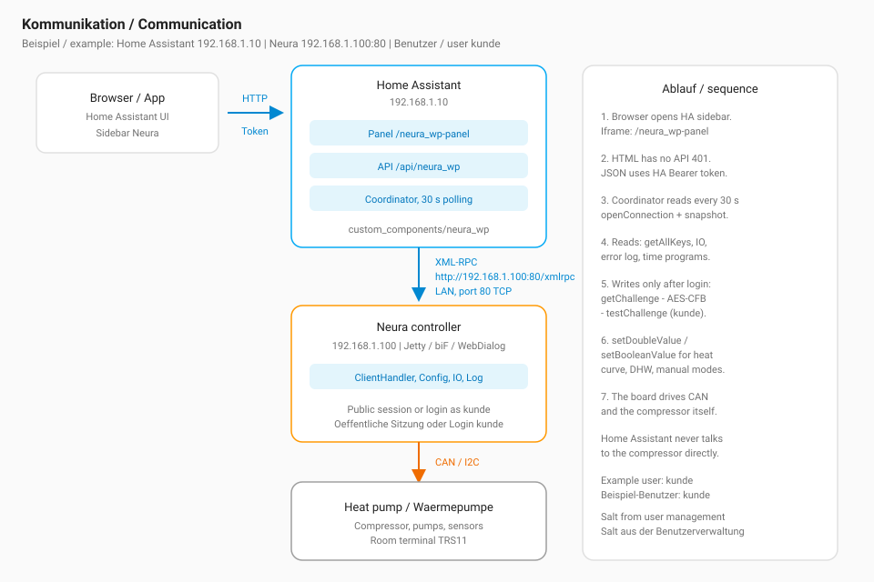
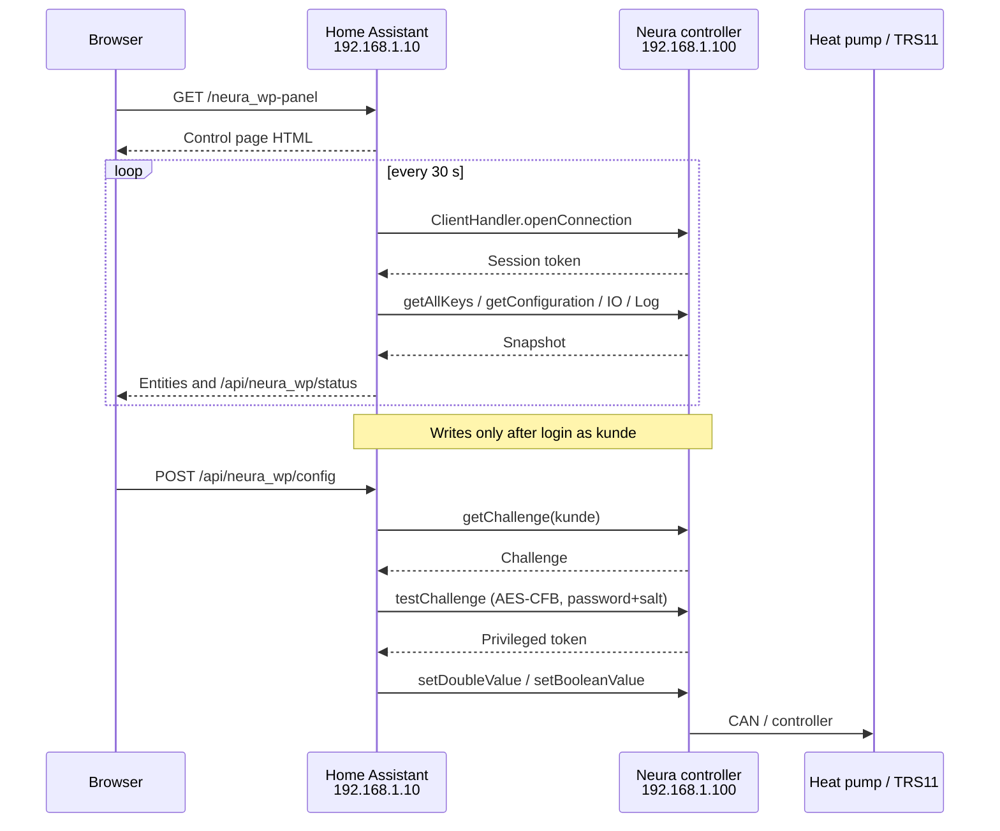

# Neura heat pump for Home Assistant

Custom integration (`neura_wp`) that connects a Neura heat pump with WebDialog / biF on the local network to Home Assistant.

The **controller stays on the board**. CAN, the room terminal (TRS11) and compressor logic are not replaced. Home Assistant talks to the same XML-RPC service as the original WebDialog, writes the same configuration keys and serves the control page in the sidebar. You do not need an extra computer with a Python environment.

| | Example (replace these) |
|---|---|
| Home Assistant | `192.168.1.10` |
| Heat pump | `192.168.1.100` port `80` |
| Username | `kunde` (Kunde role) |
| Password / salt | enter locally only, never in Git |

Version **0.2.2**. Polling every **30 seconds**.

- [Installation](docs/INSTALLATION.en.md)
- [Deutsche Fassung](README.de.md)

## What it provides

- A Home Assistant device with climate (heat curve), water heater, sensors, binary sensors, switches and numbers
- Overview values as entities, including manual modes (Handbetriebe)
- Control page under **Neura** in the left sidebar (same UI as the local web panel)
- Read access without login; writes only with user `kunde` (or another controller user), password and salt

It does **not** force the compressor off. There is no HVAC off mode here.

## Installation (short)

1. Copy `custom_components/neura_wp` in full to `config/custom_components/neura_wp` (keep `www`).
2. Restart Home Assistant.
3. Settings → Devices & services → Add integration → **Neura Wärmepumpe**.
4. Host `192.168.1.100`, port `80`. For write access use username `kunde`, password and salt.

Full steps: [docs/INSTALLATION.en.md](docs/INSTALLATION.en.md).

## How Home Assistant talks to the pump

Home Assistant and the heat pump sit on the same LAN. The integration does **not** use a cloud. The browser only talks to Home Assistant; Home Assistant talks to the pump.



### Who talks to whom

```
Browser  --HTTP/session-->  Home Assistant (192.168.1.10)
                                  |
                                  | XML-RPC, port 80
                                  v
                         Neura controller (192.168.1.100)
                                  |
                                  | CAN / I2C (internal)
                                  v
                         compressor, pumps, TRS11
```

1. **Browser → Home Assistant**  
   The sidebar loads `/neura_wp-panel` in an iframe (no API 401; that URL is only the HTML UI). JSON calls go to `/api/neura_wp/status`, `/heating`, `/cylinder`, `/holiday`, `/config`, `/user`, `/power` and send the Home Assistant access token. The pump never sees the browser.

2. **Home Assistant → controller**  
   The `neura_wp` coordinator opens an XML-RPC session every 30 seconds against

   `http://192.168.1.100:80/xmlrpc`

   The path is `/xmlrpc` at the HTTP root, not under `/neura`. The Java services on the board (Jetty / biF / Apache XML-RPC) expect fully qualified handler names, for example `com.bitservice.bifclient.ClientHandler.openConnection`.

3. **Controller → hardware**  
   Only the board talks CAN and the room terminal. Home Assistant at most writes configuration keys that the original WebDialog also writes (`neura.heatcurve.hc_starttemp`, manual-mode flags, …). Compressor logic stays there.



### Public session and login

Without a username the integration only calls `openConnection`. Many values can be read. Writes are rejected until the session is privileged.

With user `kunde`:

1. `openConnection` returns a public token.
2. `getChallenge("kunde")` returns random bytes.
3. The password is hashed with the **salt of kunde** (SHA-1, 512 rounds) and the challenge is wrapped with AES-CFB (same as the original WebDialog).
4. `testChallenge` swaps the token for a privileged session.

The salt is shown in the controller user management. It is per-user and must not be committed to Git.

If the session expires (`Not authenticated yet`), the client opens a new one. The controller limits parallel connections (typically 10).

### What gets written

| Action in Home Assistant | XML-RPC (simplified) |
|---|---|
| Heat-curve start | `setDoubleValue` on `neura.heatcurve.hc_starttemp` |
| DHW setpoint | first time window, e.g. `neura.cylinder.timeframe_1_temp` |
| Holiday | `neura.holiday.active` |
| Manual modes | flags such as `neura.runtime.room_man_temp_flag`, `neura.runtime.cp_endurance_run` |
| Inverter manual | `neura.runtime.pcs_manual` (`-1` = automatic) |
| Add user / password | `UserManagementClientHandler` |
| Restart controller | `ClientHandler.doRestart` |

There is no OS shutdown over XML-RPC. `doRestart` only restarts the Java controller.

## Entities

Device: **Neura Wärmepumpe**. Unique IDs use the host, e.g. `192.168.1.100-…`.

### Overview

| Entity | Meaning |
|---|---|
| Climate *Heizkurve* | Flow temperature, heat-curve start, curve points as attributes. Heat mode only. |
| Water heater | First time-window setpoint, attributes enabled/running |
| Temperatures / pressures | All analog points the controller reports (flow, return, room, outdoor, …) |
| Digital inputs and outputs | Heat pump, pumps, heater rod, high/low pressure, TMAX, utility lock |
| *Aktueller Heizsollwert* | `neura.heatrequest.targetvalue` |
| Operating hours | Heat pump, DHW, compressor, mixer |
| *Letzter Fehler* | Live alarm; old log rows are historic, not an active fault |
| *Zeitprogramme* | Count plus raw programs as attributes |
| *Warmwasser aktiv* | Cylinder enable |
| *Schreibzugriff* | Whether the session is logged in as `kunde` (or similar) |
| Switch *Urlaub* | `neura.holiday.active` |

### Manual modes (Handbetriebe)

Same items as the original **Handbetriebe** menu:

| Entity | Key |
|---|---|
| Temporary manual | `neura.runtime.room_man_temp_flag` |
| Permanent manual | `neura.runtime.room_man_perm_flag` |
| Mixer temporary / permanent / force run | `neura.mixer.temp_flag` / `perm_flag` / `force_run` |
| Circulator endurance | `neura.runtime.cp_endurance_run` |
| Cylinder rapid load | `neura.cylinder.temporary_load` |
| Rapid-load temperature | `neura.cylinder.temporary_temperature` |
| Force defrost | `neura.runtime.force_dedew` |
| Brine / submersible pump manual | `neura.runtime.uwap_manual` |
| F2 / rapid key | `neura.runtime.f2_pressed` |
| Inverter manual (−1 = automatic) | `neura.runtime.pcs_manual` |

Further setup menus (heat curve, cylinder, statistics, users, …) live on the **control page** in the sidebar; not every field is a separate entity.

## Control page in Home Assistant

After setup, **Neura** appears in the sidebar. The page uses the configured connection; the connect form is hidden there.

Without a privileged login, write controls stay disabled. With user `kunde` and salt, the menus behave like WebDialog: setup, manual modes, statistics, user management, controller restart.

The HTML lives in `custom_components/neura_wp/www/index.html`. Home Assistant serves it at **`/neura_wp-panel`** (no API 401). Data calls go to **`/api/neura_wp/…`** and send the Home Assistant token (`Authorization: Bearer …`).

An iframe pointed at `/api/neura_wp/panel` (version 0.2.0) shows `401: Unauthorized` while entities still work. From **0.2.1** copy the folder again and restart Home Assistant.

## Limits and security

- Local network only. There is no remote access through the pump itself; use Home Assistant’s own protection.
- Credentials stay in the Home Assistant config entry, not in this repository.
- The public session is for reading. Writes need the salt.
- Historic fault log rows (old timestamps) are not a live alarm.
- `doRestart` interrupts the controller briefly. Do not trigger it lightly.
- The board typically allows about 10 XML-RPC sessions. The integration closes and renews its own session.

## Troubleshooting

| Symptom | Typical cause |
|---|---|
| Integration cannot find the pump | Wrong host, pump not on the same LAN, port 80 closed |
| “No such handler” | Outdated client; this version uses the Java FQ names |
| “Not authenticated yet” | Session expired; the client reconnects. If it persists, check credentials |
| Values readable, save fails | User `kunde`, password or salt missing / mismatch |
| Sidebar shows 401 | Copy integration 0.2.1 or newer and restart Home Assistant. The page is `/neura_wp-panel`, not under `/api/`. |
| Sidebar shows 500 | Copy **0.2.2** (HTML response without a duplicate charset) and restart Home Assistant. |
| FROST or similar as an alarm | Check whether the entry is historic (`historic` attribute) |

## Files included

The integration is only the files under `custom_components/neura_wp/` (see [Installation](docs/INSTALLATION.en.md)). Firmware, image patches and an optional `web/server.py` are **not** part of this package.

## License

MIT, see [LICENSE](LICENSE). Neura, WebDialog and related marks belong to their owners. This integration is independent.
