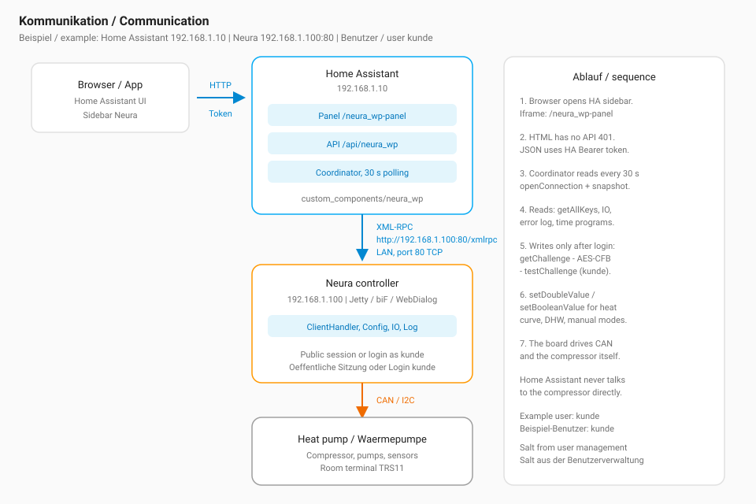

# Neura Wärmepumpe / Neura heat pump

Home Assistant custom integration for Neura WebDialog / biF heat pumps on the local network.

Die Regelung bleibt auf der Platine. Diese Integration spricht denselben XML-RPC-Dienst wie das Original-WebDialog, stellt Übersicht und Handbetriebe als Entitäten bereit und zeigt die Bedienseite in der Home-Assistant-Seitenleiste. Ein extra Python-Rechner ist nicht nötig.

The controller stays on the heat-pump board. This integration talks to the same XML-RPC service as the original WebDialog, exposes overview data and manual modes as entities, and serves the control page in the Home Assistant sidebar. No extra Python host is required.

| | |
|---|---|
| **Deutsch** | [Vollständige Dokumentation](README.de.md) · [Installation](docs/INSTALLATION.de.md) |
| **English** | [Full documentation](README.en.md) · [Installation](docs/INSTALLATION.en.md) |

Version **0.2.2** · Domain `neura_wp` · local polling every 30 seconds

In allen Beispielen gilt: Pumpe `192.168.1.100`, Home Assistant `192.168.1.10`, Benutzer `kunde`. Ersetzen Sie diese Werte durch Ihre Anlage.

Examples throughout use pump `192.168.1.100`, Home Assistant `192.168.1.10`, user `kunde`. Replace them with your own values.

## Kurzinstallation / Quick install

1. Copy `custom_components/neura_wp` into `config/custom_components/neura_wp` (keep the `www` folder).
2. Restart Home Assistant.
3. Settings → Devices & services → Add integration → **Neura Wärmepumpe**.
4. Host `192.168.1.100`, port `80`. Username `kunde`, password and salt are only needed for write access.

Sidebar item **Neura** opens `/neura_wp-panel` (not `/api/…`, that would be 401). JSON uses `/api/neura_wp` with the Home Assistant token.

---

1. `custom_components/neura_wp` nach `config/custom_components/neura_wp` kopieren (`www` nicht weglassen).
2. Home Assistant neu starten.
3. Einstellungen → Geräte und Dienste → Integration hinzufügen → **Neura Wärmepumpe**.
4. Adresse `192.168.1.100`, Port `80`. Benutzer `kunde`, Passwort und Salt nur für Schreibzugriff.

In der Seitenleiste erscheint **Neura** (`/neura_wp-panel`, nicht `/api/…` — sonst 401). JSON läuft über `/api/neura_wp` mit dem Home-Assistant-Token. Das Salt steht in der Benutzerverwaltung der Regelung.

## Kommunikation / Communication

